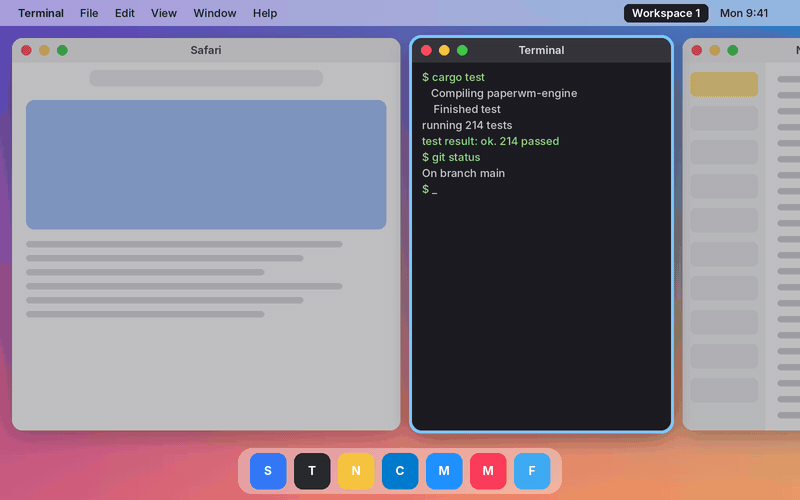

<p align="center">
  
</p>

<h1 align="center">PaperWM for macOS</h1>

<p align="center">
  Your windows, laid out side by side on an endless strip of paper.<br>
  A port of <a href="https://github.com/paperwm/PaperWM">PaperWM</a>, the scrollable tiling window manager, to macOS.
</p>



<sub>A scripted model of the layout, rendered by `scripts/demo-gif.py`; not a screen recording.</sub>

---

Every new window opens as a column to the right of the one you're on. Move along the strip with the keyboard or
the trackpad, and the strip slides to bring the window you want into view. Nothing overlaps, nothing shrinks to
fit, and you never drag a window into place again.

- 🦀 A Rust engine and a Swift menu bar app, shipped as one `.app`
- 🔐 Needs only Accessibility permission; System Integrity Protection stays on
- 🧪 Built and unit-tested in CI, but **not yet tested by hand on a real Mac**: expect rough edges

## ✨ Highlights

- 📜 **Scrolling strip** of columns you can rearrange, resize, stack and tab from the keyboard
- 🗂️ **Nine workspaces** per monitor, independent of macOS Spaces
- 🖐️ **Trackpad panning** and **drag to reorder** with the mouse
- 🔀 **Window switcher** with live previews, and a **minimap** of the strip
- 📌 **Pinned columns**, a **scratch layer** for floating windows, and **app rules**
- ⚙️ **Settings** for gaps, widths, animations, colours, and every shortcut

<details>
<summary><b>All features in detail</b></summary>

- **Scrolling strip**: every window opens as a new column to the right of the focused one, focusing a column slides the strip to bring it into view, and columns can be rearranged, resized and stacked from the keyboard. Dialogs, sheets, other non-standard windows and fixed-size windows such as Calculator float. A window in native fullscreen is left alone and keeps its column, and goes back into it when it leaves fullscreen. Columns that scroll off screen are parked at the screen edge, since macOS doesn't allow hiding windows entirely off screen.
- **Tabbed columns**: ⌃⌥T turns the focused column's stack into tabs: only the active window shows, at the column's full height, with the others behind it. A small tab bar along the bottom of the column lists its windows; click a tab, or use ⌃⌥↑/↓, to switch.
- **Pinned columns**: pin a column to the left or right edge of the screen; it stays there at full height while the rest of the strip scrolls in the width beside it. One pin per side per workspace, and pins always leave room for a narrow column beside them; focus left and right still reaches a pin.
- **Drag to reorder**: drag a window by its title bar onto another column and let go: it takes that column's place and the strip rearranges around it. A window dragged out of a stack gets a column of its own, and dropping onto another monitor moves it into that monitor's strip.
- **Native tabs**: a window with tabs (Finder, Terminal, Safari) is one column; opening, switching or closing tabs keeps it in place, and a tab dragged out into its own window gets a column of its own.
- **Workspaces**: nine PaperWM workspaces, independent of macOS Spaces (keep everything on one Space). Each monitor shows one; the others' windows are tucked into a screen corner. Focusing a window that lives on a hidden workspace (⌘Tab, Dock, a click on a notification) brings its workspace in.
- **Monitors**: focus or move windows to the monitor on the left or right. A column that would spill onto another monitor is tucked away against the other edge.
- **Scratch layer**: floating windows above the workspaces that you can show or hide together.
- **Window switcher**: ⌃⌥Tab through recently used windows across all workspaces, with live previews if you grant Screen Recording permission (app icons otherwise).
- **Trackpad**: hold ⌃⌥ (or the modifiers of your Switch Windows shortcut, if you changed it) and scroll with two fingers sideways to pan the strip (focus lands on the column in the middle when you let go), or up/down to switch workspace. macOS reserves three-finger swipes, so this stands in for PaperWM's.
- **Minimap**: an overview of the strip appears briefly while you navigate. In Settings, pick the strip view or a small toolbar of app icons along the bottom of the screen (one per column, focused one highlighted).
- **Focus highlight**: optionally draw a colored border around the focused window and dim the windows behind it. Both are off by default; turn them on from the menu, Settings or their shortcuts. With Screen Recording permission the border matches each window's own rounded corners; otherwise it uses the corner radius set in Settings.
- **App rules**: in Settings › Apps, pick an app from the running ones (or from the Applications folder) and either float it, so its windows are never tiled or moved and stay on every workspace like dialogs, or give it a fixed slot: its windows open at a set column of a set workspace. Apps are matched by name. Fixed-size windows float even when their app has a slot.
- **Menu bar**: shows the current workspace's name; the menu switches workspaces, toggles the focus border and dimming, and opens Settings.
- **Settings** (⌘, from the menu): launch at login, gaps, column width presets, the widen / narrow step, scroll animation length (0 turns it off), whether to keep the focused column centred (never, when the columns overflow the screen, or always), keep original height (off by default: a window alone in its column keeps the height it had when first tiled, top-aligned, instead of filling the screen; stacked columns still split the full height), workspace names, app rules, minimap style, border color and width, dim strength, and every shortcut can be re-recorded.

</details>

## ⌨️ Keyboard shortcuts

⌃⌥ stands in for PaperWM's Super key. Within each group a key focuses or switches, and adding ⇧ takes the focused window along (or gives the opposite or vertical variant). Every shortcut uses keys found on laptop keyboards without Fn and at most three modifiers. All of them can be changed in Settings, where they are listed by the same groups.

**Focus and move**

| Shortcut | Action |
| --- | --- |
| ⌃⌥ ← / → | Focus the column on the left / right |
| ⌃⌥ ↑ / ↓ | Focus the window above / below in the column |
| ⌃⌥⌘ ← / → | Focus the first / last column |
| ⌃⌥⇧ ← / → | Move the column left / right |
| ⌃⌥⇧ ↑ / ↓ | Move the window up / down in its column |

**Workspaces**

| Shortcut | Action |
| --- | --- |
| ⌃⌥ 1…9 | Switch to workspace 1…9 |
| ⌃⌥⇧ 1…9 | Move the window to workspace 1…9 |
| ⌃⌥ [ / ] | Previous / next workspace |
| ⌃⌥⇧ [ / ] | Move the window to the previous / next workspace |
| ⌃⌥ \` | Back to the last used workspace |

**Monitors**

| Shortcut | Action |
| --- | --- |
| ⌃⌥ , / . | Focus the monitor on the left / right |
| ⌃⌥⇧ , / . | Move the window to the monitor on the left / right |

**Size**

| Shortcut | Action |
| --- | --- |
| ⌃⌥ R | Cycle column width (⅓, ½, ⅔ of the screen) |
| ⌃⌥ F | Toggle full width |
| ⌃⌥ = / - | Widen / narrow the column (by 10% of the screen; set the step in Settings) |
| ⌃⌥⇧ = / - | Make the window taller / shorter in its stacked column (by 10% of the column; set the step in Settings) |
| ⌃⌥ E | Give every window in the column the same height |

**Column layout**

| Shortcut | Action |
| --- | --- |
| ⌃⌥ C | Center the column |
| ⌃⌥ I | Pull the next column's window into this column |
| ⌃⌥ O | Push the focused window out into its own column |
| ⌃⌥ T | Toggle the column between stacked and tabbed |
| ⌃⌥ P / ⌃⌥⇧ P | Pin the column to the left / right edge, or unpin it |

**Switcher and scratch layer**

| Shortcut | Action |
| --- | --- |
| ⌃⌥ Tab / ⌃⌥⇧ Tab | Switch windows (release ⌃⌥ to pick, ⌃⌥ Esc to cancel) |
| ⌃⌥ Esc | Show or hide the scratch layer |
| ⌃⌥⇧ Esc | Move the window to or from the scratch layer |

**Appearance**

| Shortcut | Action |
| --- | --- |
| ⌃⌥ B | Show or hide the focus border |
| ⌃⌥ D | Dim background windows on or off |

## 🔑 Permissions

- **Accessibility** (required): to move, resize and focus windows, and to read the trackpad while ⌃⌥ is held.
- **Screen Recording** (optional): for window previews in the switcher, and to match the focus border to each window's rounded corners. macOS asks the first time you open the switcher.

## 🛠️ Building

Requirements: macOS 14 or later, Xcode 15 or later (for Swift), and Rust via [rustup](https://rustup.rs).

```sh
rustup target add aarch64-apple-darwin x86_64-apple-darwin
scripts/build-app.sh               # this Mac's architecture
scripts/build-app.sh --universal   # Apple Silicon and Intel
open build/PaperWM.app
scripts/make-dmg.sh                # optional: package as build/PaperWM-<version>.dmg
```

CI builds a universal disk image on every push and pull request; download it from the run's **PaperWM-dmg** artifact.
Pushing a `v*` tag also publishes the disk image as a GitHub release.

On first launch macOS asks you to grant Accessibility access in System Settings › Privacy & Security › Accessibility. Builds are signed ad hoc, so after rebuilding you may need to remove PaperWM from that list and add it again.

Engine tests run anywhere, including Linux:

```sh
cargo test
```

## 🗺️ Layout

| Path | Contents |
| --- | --- |
| `engine/` | Rust engine: scrolling layout (`workspace.rs`, `placement.rs`), workspaces, monitors, scratch layer, window sync and commands (`engine.rs`), macOS Accessibility backend (`macos/`), C interface (`ffi.rs`, `include/paperwm_engine.h`) |
| `app/` | Swift menu bar app (SwiftPM package): hot keys, settings, minimap, switcher, trackpad gestures, window drops, app and monitor tracking; links the engine as a static library |
| `scripts/build-app.sh` | Builds both and assembles `build/PaperWM.app` |
| `scripts/make-dmg.sh` | Packages the app as a `.dmg` |
